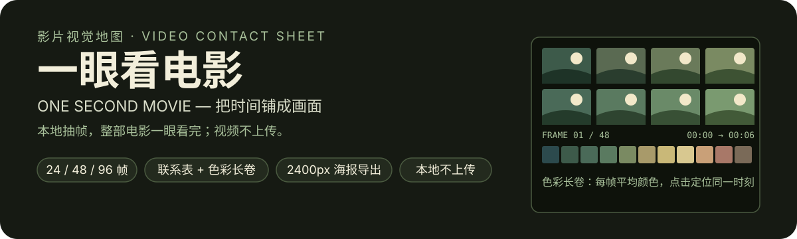
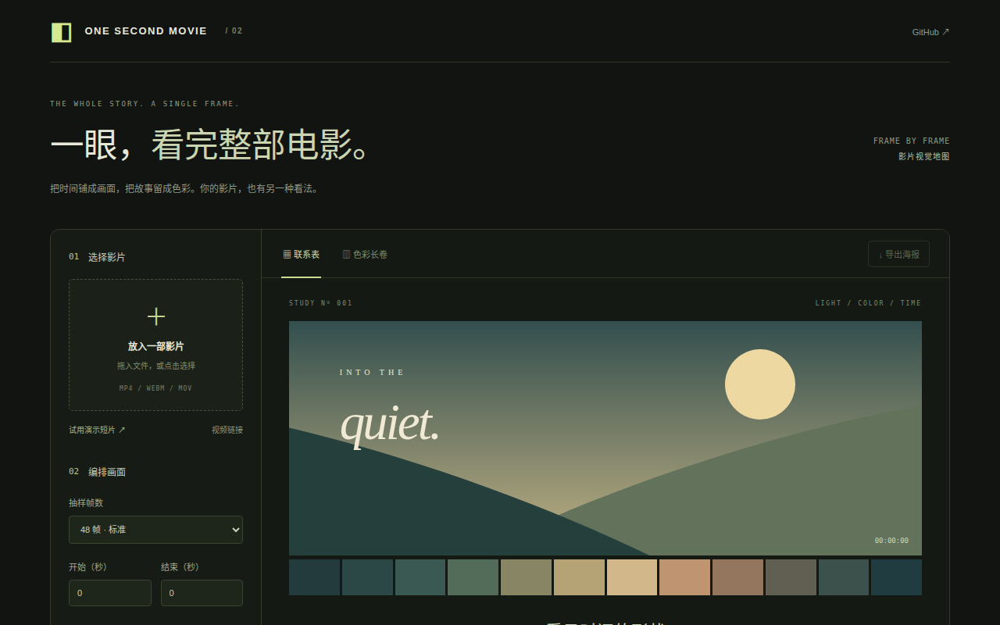
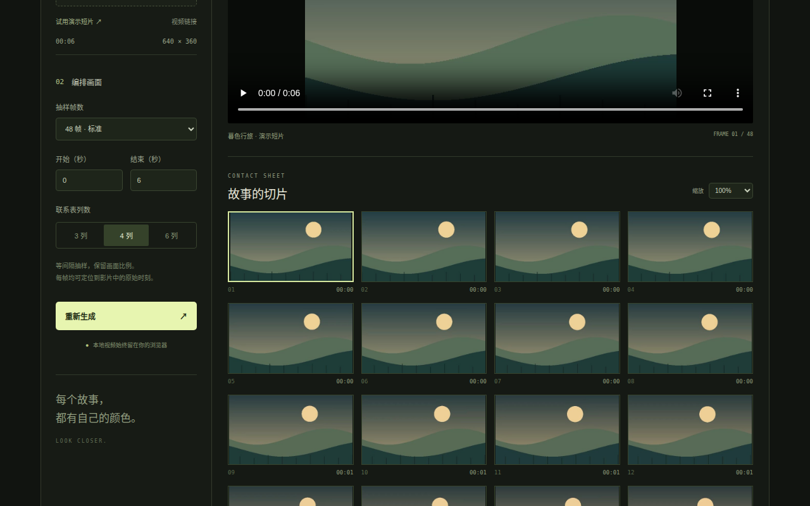

<p align="right"><a href="README.md">中文</a></p>

<p align="center">
  
</p>

<p align="center">
  <a href="https://holynova.github.io/one_second_movie/">▶ Live Demo</a>
  ·
  <a href="https://github.com/holynova/one_second_movie">GitHub Repository</a>
</p>

One Second Movie turns a film into an explorable visual map: it samples frames at equal intervals right in your browser and lays them out as a contact sheet or a color strip — a two-hour movie at a single glance. No upload, no account, no API key, no backend; frames are extracted with the browser's own video decoder.

## Screenshots

<p align="center">
  
  
</p>

## Features

- **Local extraction**: pick a local video (MP4 / WebM / MOV, depending on browser codec support) or a CORS-enabled HTTP(S) direct link. Video platform watch pages can't be sampled directly.
- **Equal-interval sampling**: 24 / 48 / 96 frames within a chosen time range, with real progress and cancellation. This is interval sampling, not shot detection.
- **Contact sheet**: 3 / 4 / 6 columns, 100%–200% zoom; click any thumbnail to seek the original video to that moment.
- **Color strip**: each frame's average color, laid out as a strip; click a color to jump to the same moment.
- **Poster export**: both modes export a 2400 px-wide PNG poster (contact sheet height varies by row count; color strip is 2400×1200).
- **Demo short**: a bundled 6-second original procedural animation (`demo-film.mp4`, 「暮色行旅」 "Twilight Journey") so you can try it without finding a film.

## Limits

- Exported thumbnails are 480×270 to bound memory; original playback stays full resolution.
- Remote direct links need the server to allow CORS; long films take as long as decoding and random seeking take.
- The legacy `server/` FFmpeg implementation is kept for historical reference; the default dev, build, and deploy flows no longer call it.

## Run Locally

Requires Node.js 24+:

```bash
npm --prefix client ci
npm run dev      # Dev server
npm test         # Node's built-in tests
npm run build    # Production output: client/dist
```

GitHub Actions builds automatically on push to main and updates the `gh-pages` branch.

## Tech

- React 19 + TypeScript + Vite + Tailwind CSS; frame extraction lives in `client/src/lib/video.ts`, seeking frame by frame with `<video>` + `<canvas>`, capturing frames and computing average colors.
- Poster export is in the same file (`poster()`): a 2400 px-wide canvas, with contact-sheet and color-strip layouts.

```
client/src/App.tsx        Main UI: pick a film, sampling settings, contact sheet / color strip, export
client/src/lib/video.ts   Frame extraction, average color, poster export
client/src/components/    Layout, Upload
client/public/demo-film.mp4   Demo short (6-second original procedural animation)
server/                   Legacy FFmpeg implementation (historical reference, no longer used by default)
tests/video.test.mjs      Timestamp boundary tests and more
```
