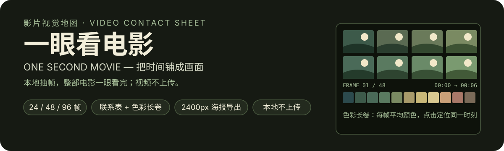
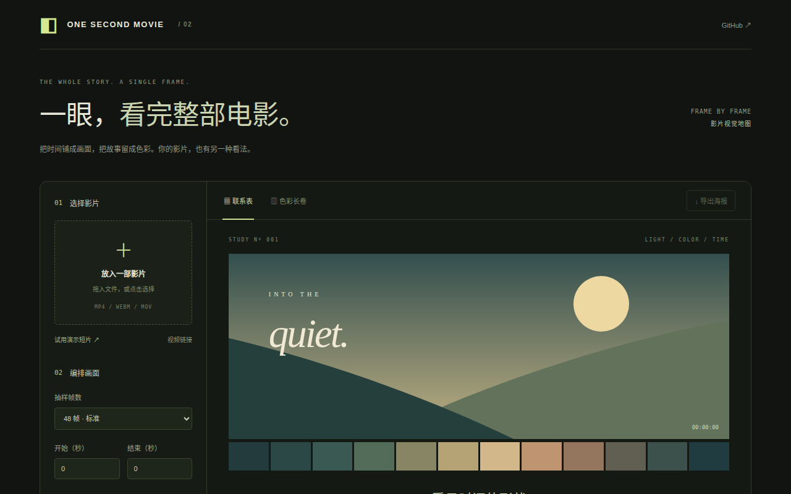
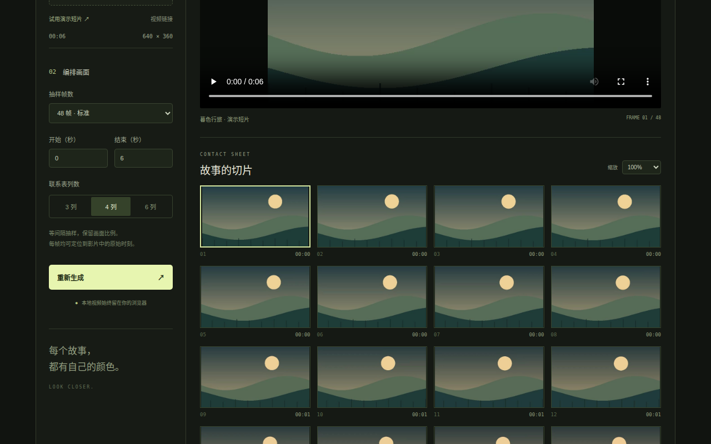

<p align="right"><a href="README.en.md">English</a></p>

<p align="center">
  
</p>

<p align="center">
  <a href="https://holynova.github.io/one_second_movie/">▶ 在线体验</a>
  ·
  <a href="https://github.com/holynova/one_second_movie">GitHub 仓库</a>
</p>

一眼看电影把一部影片变成可探索的视觉地图：在浏览器本地等间隔抽帧，拼成联系表或色彩长卷，两小时的电影一眼扫完。视频不上传、无需账号与 API Key、没有后台服务；抽帧用浏览器自己的视频解码器完成。

## 截图

<p align="center">
  
  
</p>

## 功能

- **本地抽帧**：选本地视频（MP4 / WebM / MOV，取决于浏览器编解码支持），或允许跨域读取的 HTTP(S) 视频直链；视频平台的播放页链接不可直接抽帧。
- **等间隔采样**：在指定时间范围内抽 24 / 48 / 96 帧，显示真实完成进度，可中途取消；是等间隔采样，不是镜头语义识别。
- **联系表**：3 / 4 / 6 列排布，100%–200% 缩放，点击缩略图定位到原片对应时刻。
- **色彩长卷**：每帧取平均颜色拼成长卷，点击色条定位同一时刻。
- **导出海报**：两种模式均可导出 2400 px 宽 PNG 海报（联系表按行数定高，色彩长卷 2400×1200）。
- **演示短片**：随附原创程序化动画 `demo-film.mp4`（6 秒，「暮色行旅」），不用找片就能试。

## 边界

- 导出缩略帧为 480×270，以限制内存；原片播放保持原分辨率。
- 远程直链需要服务端允许 CORS；长片耗时取决于解码与随机寻址性能。
- 旧版 `server/` FFmpeg 实现保留供历史参考，默认启动、构建与发布不再调用它。

## 本地运行

需要 Node.js 24+：

```bash
npm --prefix client ci
npm run dev      # 开发服务器
npm test         # Node 内置测试
npm run build    # 生产输出为 client/dist
```

GitHub Actions 在 push 到 main 时自动构建并更新 `gh-pages` 分支。

## 技术

- React 19 + TypeScript + Vite + Tailwind CSS；抽帧在 `client/src/lib/video.ts`，用 `<video>` + `<canvas>` 逐帧 seek、抓图、算平均色。
- 海报导出同在 `video.ts`（`poster()`）：2400 px 宽画布，联系表与色彩长卷两种版式。

```
client/src/App.tsx        主界面：选片、抽样设置、联系表/色彩长卷、导出
client/src/lib/video.ts   抽帧、平均色、海报导出
client/src/components/    Layout、Upload
client/public/demo-film.mp4   演示短片（6 秒原创程序化动画）
server/                   旧版 FFmpeg 实现（历史参考，不再默认使用）
tests/video.test.mjs      时间戳边界等测试
```
